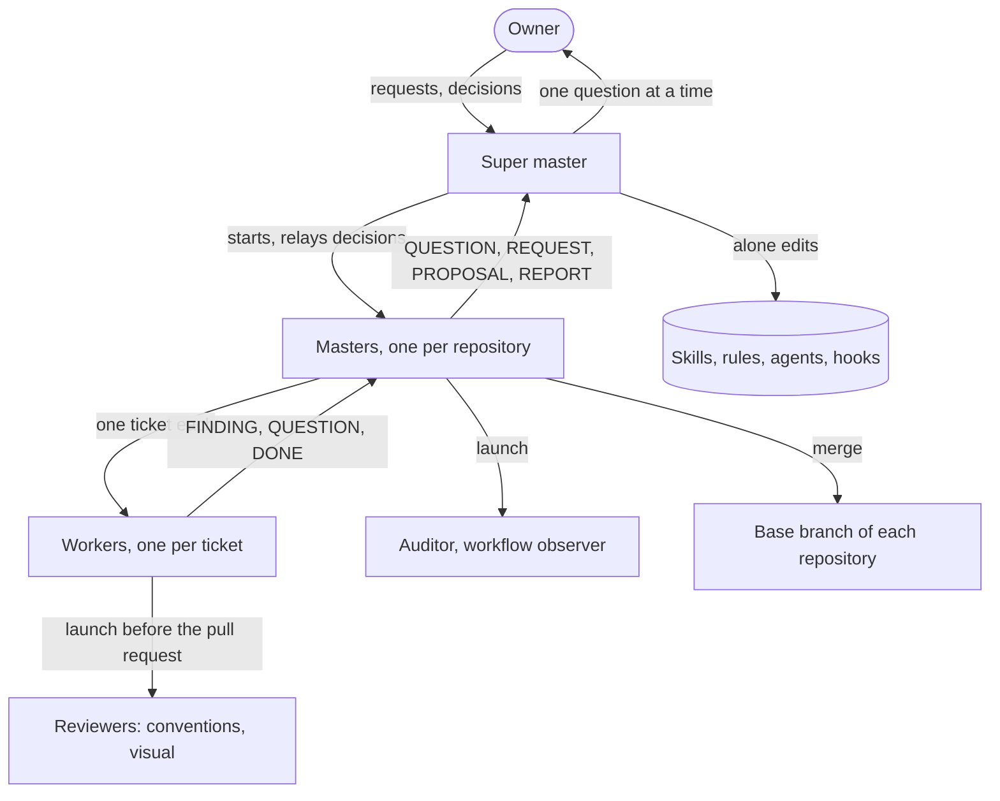

# Overview

The owner decides. A super master coordinates one master per repository. Each master turns the problems of its repository into tickets and gives each ticket to a worker. Short-lived sub-agents review, audit and observe.

## Levels

- **Super master**: the only agent the owner talks to by default. It starts and restarts the masters, relays the owner's decisions, drives the Cloudflare dashboard, sets the worker capacity, and alone changes the shared skills, rules and agents. It does no ticket itself.
- **Masters**: one per repository, in its main checkout on the base branch (`develop`, or the default branch without it). A master keeps the board, prioritizes, starts workers, checks and merges their pull requests. It never implements a ticket.
- **Workers**: one per ticket, each in its own Git worktree and terminal workspace. A worker implements, tests, has its work reviewed, opens the pull request and reports. It never merges.
- **Sub-agents**: launched with a written brief, since they do not see the conversation. Most are read-only.

## Principles

- **Coordinators do not implement, implementers do not merge.** Each pull request is checked by an agent that did not write it.
- **One voice.** The owner hears from the super master, unless they open a master's or a worker's workspace and talk to it directly, which every agent allows: the owner's word comes first, and the agent tells its parent.
- **State lives in files, not in context.** Each master keeps a short state file and reads a handover at its start, so a restart or a compaction of its context loses nothing.
- **Short instructions.** A charter gives what an agent cannot read for itself and points to the rest, since every line costs tokens on every turn of every agent.
- **Conventions are written once.** Skills hold them, rules load them when the matching files are touched, and the reviewers check them.
