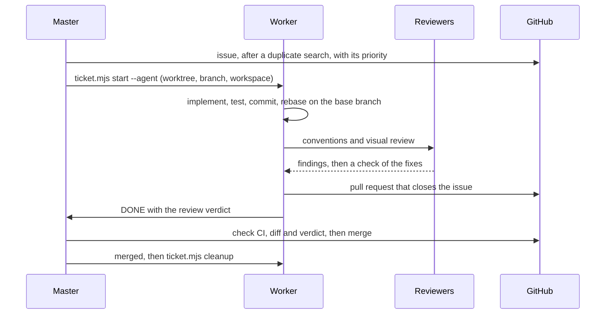

# Life of a ticket

## Steps

1. **Ticket.** A request of the owner, a worker's `FINDING` or an auditor's finding becomes a GitHub issue, in English, after at least two duplicate searches. It goes into the repository's GitHub Project with a status and a priority, from P0 (a broken build, a site down, an exposed secret) to P3 (polish). A ticket that unblocks others, then the cheapest, starts first.
2. **Start.** `ticket.mjs start <ref> --agent` creates a worktree in a folder that Spotlight skips (`worktrees.noindex/repo.ISF-35`), on a branch named after the ticket reference and taken from the base branch, sets the ticket *In Progress*, opens a cmux workspace and launches a worker in it.
3. **Implementation.** The worker reads the issue, restates its acceptance criteria, and asks rather than guesses. It makes atomic Conventional Commits with a `Refs: ISF-35` footer, after the project's checks pass on the whole tree. It rebases on the base branch, never merges it in, so the history stays linear.
4. **Review** by two independent agents: see [Reviews and quality](reviews-and-quality.md).
5. **Pull request** against the base branch, with `Closes #35`, a test plan and the review verdict. Every figure in it is copied from a command run on the final state. The worker waits for the CI, fixes it, checks that the base has not moved, then sends `DONE`.
6. **Merge.** The master checks the pull request on GitHub itself: green checks, mergeable, a diff that matches the ticket, a verdict with no finding left. It merges with a merge commit, one pull request at a time, and tells the other workers that the base moved. A change of layout waits for the owner, who sees its before and after screenshots.
7. **Cleanup.** `ticket.mjs cleanup` ends the worker's session, removes the worktree and closes the workspace, and keeps any worktree that still holds uncommitted work or unmerged commits.

## Why one worktree per ticket

- **Parallel work without interference.** Each worker has its own files, dependencies, build output and dev server port. Nothing is stashed or switched, and one worker's failing build never blocks another.
- **A clean main checkout.** The master stays on an up-to-date base branch, so its view of the repository is always the merged state.
- **Disposable.** A worktree weighs about 200 MB with its dependencies. Removing it after the merge frees disk and memory, and a fresh one starts from the latest base.
- **Fewer conflicts.** Two tickets that touch the same files never run at once: the second starts after the first is merged.

## The board

The cmux sidebar reads like a board: one pinned, colored group per ticket status (*Backlog*, *Todo*, *In Progress*, *In Review*, *Blocked*, *Done*), and one workspace per ticket, titled after its branch. `ticket.mjs sync` refiles the workspaces when statuses change.
