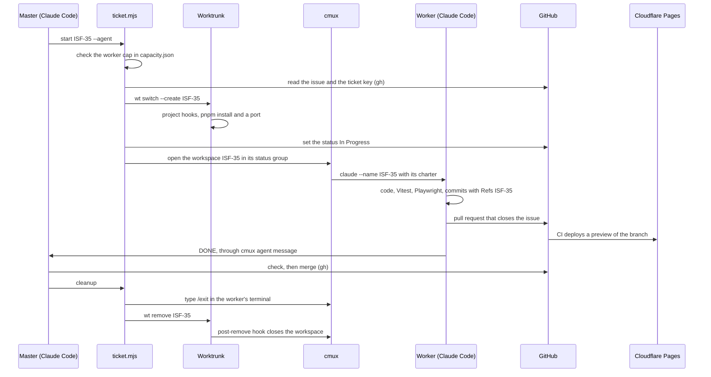

# Tooling

The fleet runs on one machine: a dozen Claude Code sessions at a time, each in its own terminal workspace and, for a worker, in its own Git worktree. A few tools and scripts make that possible. The versions were read on the machine on 2026-10-20, with `--version`, or from the lockfile of [issoufi.fr](https://github.com/AIssoufi/issoufi.fr) for the project tools.

| Tool | Version | Role in the fleet | Details |
| --- | --- | --- | --- |
| [Claude Code](https://claude.com/claude-code) | 2.1.303 | Runs every agent: an interactive session per super master, master and worker, and the sub-agents they launch | [Claude Code](tooling-claude-code.md) |
| [cmux](https://github.com/manaflow-ai/cmux) | 0.65.2 | A terminal with one workspace per agent, messages between agents, and a sidebar that reads like a board | [cmux](tooling-cmux.md) |
| [Worktrunk](https://github.com/max-sixty/worktrunk) (`wt`) | 0.80.0 | Creates and removes the Git worktree of each ticket, and runs hooks around it | [Worktrunk](tooling-worktrunk.md) |
| Scripts of the setup | | Start, track and clean up the tickets, keep the journal, read the quota, measure the fleet | [Scripts](tooling-scripts.md) |
| [GitHub CLI](https://cli.github.com) (`gh`) | 2.102.0 | Issues, project fields, pull requests, checks and merges | [GitHub](tooling-github.md) |
| pnpm, Vite, Vitest, Playwright | 10.34.7, 8.3.4, 4.1.11, 1.64.0 | Install, build, unit tests, browser tests and screenshots | [Build, test and deploy](tooling-build-and-deploy.md) |
| [Cloudflare](https://www.cloudflare.com) Pages and Workers | | Hosting, with a preview URL for each branch | [Build, test and deploy](tooling-build-and-deploy.md#cloudflare) |

Node.js 24.22.0 runs the scripts, Git 2.56.0 holds the worktrees, and jq 1.7.1 queries the session transcripts.

## How they fit together

One ticket, `ISF-35`, from its start to its merge:

1. **Start.** The master runs `ticket.mjs start ISF-35 --agent`. The script checks the worker cap that the quota steward wrote, reads the issue with `gh`, and runs `wt switch --create ISF-35 --base origin/develop`. Worktrunk creates the worktree, and the project hooks install the dependencies and give it a port. The script sets the ticket *In Progress*, opens a cmux workspace titled `ISF-35` in the group of its status, and starts a Claude Code worker there with its charter and its environment.
2. **Work.** The worker reads the issue, codes and tests in its worktree, on its own port. Its Conventional Commits, which commitlint checks, each end with a `Refs: ISF-35` trailer.
3. **Review.** It launches two sub-agents. The visual tester takes every page at four widths in one Playwright run.
4. **Pull request.** The worker opens it with `gh pr create` and `Closes #35`. GitHub Actions runs the checks and a preview is deployed on Cloudflare Pages. Once the checks pass, the worker sends `DONE` to its master with `cmux agent message`.
5. **Merge.** The master reads the pull request with `gh pr checks`, `gh pr view` and `gh pr diff`, merges it with `gh pr merge --merge --match-head-commit <sha>`, and logs it with `fleet.mjs log pr.merge`.
6. **Cleanup.** `ticket.mjs cleanup` types `/exit` into the worker's terminal through cmux and waits for the session to end. It then runs `wt remove`, whose hook closes the workspace, and refiles the sidebar.

Each tool does one part, and a script or a hook hands over to the next one. The start and the cleanup are scripts rather than steps an agent types one by one, so they happen the same way for each ticket, whichever master runs them.
